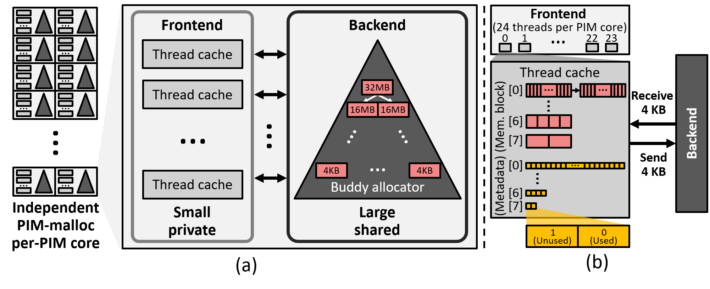

# Install and Build

## Prerequisites

Before using PIM-malloc, ensure you have the following tools and environment set up:

- **CMake**: Version 3.16 or higher
- **Ninja**: Build system generator
- **Python**: Version 3.10 or higher
- **UPMEM SDK**: Download and install from the [official UPMEM documentation](https://sdk.upmem.com/)

PIM-malloc is designed to run on **real UPMEM-PIM hardware**. Access to a UPMEM-PIM computing environment is required. Please follow the [official UPMEM documentation](https://sdk.upmem.com/) to set up your hardware.

## Installation Steps

### Step 1: Set the UPMEM SDK Path

The build system needs to know where your UPMEM SDK is installed. You can provide this in one of two ways:

**Option A: Environment variable**
```bash
export UPMEM_HOME=/path/to/upmem-2023.1.0-Linux-x86_64
```

**Option B: Command-line argument** (shown in Step 2)

### Step 2: Build All Memory Allocators

Navigate to the `script` directory and execute the `build.py` script to build all memory allocators:

```bash
cd ./script

# Using the environment variable set in Step 1:
python3 build.py

# Or, passing the SDK path directly:
python3 build.py --upmem-home /path/to/upmem-2023.1.0-Linux-x86_64
```

### Step 3: Execute a Memory Allocator

Navigate to the `build` directory and run PIM-malloc-SW. For example, to test the memory allocator, execute the following:

```bash
cd ./build
./Tests/MicrobenchmarkTest/Host/uMalloc_test_host
```

# Code Overview

## PIM-malloc-SW Allocator



`PIM-malloc-SW` uses a buddy allocator as a backend allocator while introducing a per-thread **`ThreadCache`** for efficient frontend allocation. 

### Key Operations
- **Initialization**:
  - **`initUMalloc`**: Sets up `ThreadCache` for each thread (e.g., 16 threads with size classes) and initializes the backend allocator.
  - **`initThreadCache`**: Configures free memory blocks for each size class.

- **Memory Allocation**:
  - **`allocateUMalloc`**: Allocates memory using a thread-specific `ThreadCache`. If the cache is empty:
    - Requests a 4-KB chunk from `BuddyAllocator`.
    - Splits the chunk into smaller blocks of the requested size class.
  - Example:
    ```c
    __mram_ptr void *pointer = allocateUMalloc(uMalloc, 524288);
    ```

`ThreadCache` is initialized by the `initThreadCache` function, which takes `sizeClass` as a parameter. `ThreadCache` manages multiple free memory blocks, each with a size equal to `sizeClass` bytes. When `ThreadCache` runs out of free memory blocks, it requests a 4 KB memory chunk from `BuddyAllocator`.

During memory allocation, `uMalloc` first checks the per-thread `ThreadCache` for a size class large enough to satisfy the allocation request. It then calls the `allocateThreadCache` function with the appropriate `ThreadCache`. Internally, `ThreadCache` maintains a linked list of `ThreadCacheNode` objects, each of which contains multiple free blocks of the specified size class, with an aggregate size of 4 KB.

The `allocateThreadCache` function scans the linked list of `ThreadCacheNode` objects to find an unallocated memory block. If no unallocated blocks are found, it invokes the `buddyAllocate` function to request a 4 KB memory block from the backend `BuddyAllocator`. Once the 4 KB memory block is returned, the `allocateThreadCache` function splits it into smaller blocks of `sizeClass` bytes by calling the `initThreadCacheNode` function. The newly created `ThreadCacheNode` is then added to the linked list for future allocations.

- **Memory Deallocation**:
  - **`freeUMalloc`**: Deallocates memory by locating the appropriate `ThreadCache` and updating its state.

When deallocating a memory block, the `freeUMalloc` function determines which `ThreadCache` contains the pointer to the memory block. It iteratively searches through all `ThreadCache` instances to locate the matching one. Once the appropriate `ThreadCache` is identified, `freeUMalloc` calls the `freeThreadCache` function. The `freeThreadCache` function marks the memory block as unallocated and completes the deallocation process.

> [!WARNING]
> Current deallocation involves an `O(N)` lookup process for `N` size classes, which will be optimized in future versions.

### Example Usage

```c
if (threadId == 0) {
    mem_reset();

    int sizeClasses[8] = {16, 32, 64, 128, 256, 512, 1024, 2048};
    uMalloc = initUMalloc(mallocableRegionSize, pageSize, bufferSize, DPU_MRAM_HEAP_POINTER, &sizeClasses, 8);
}
barrier_wait(&deviceBarrier);

__mram_ptr void *pointer = allocateUMalloc(uMalloc, 524288);

// Use the allocated memory

freeUMalloc(uMalloc, pointer);
```

## Future Improvements

- **Allocation Size Flexibility**: Removing size restrictions in `buddyAllocate`.
- **Deallocation Optimization**: Improving the lookup efficiency of `freeUMalloc`.

Let us know if further clarifications or optimizations are required. Contributions are welcome!
